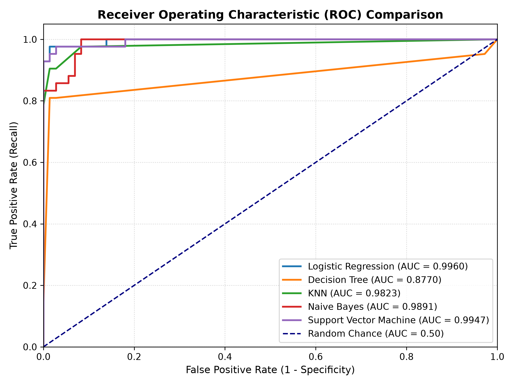
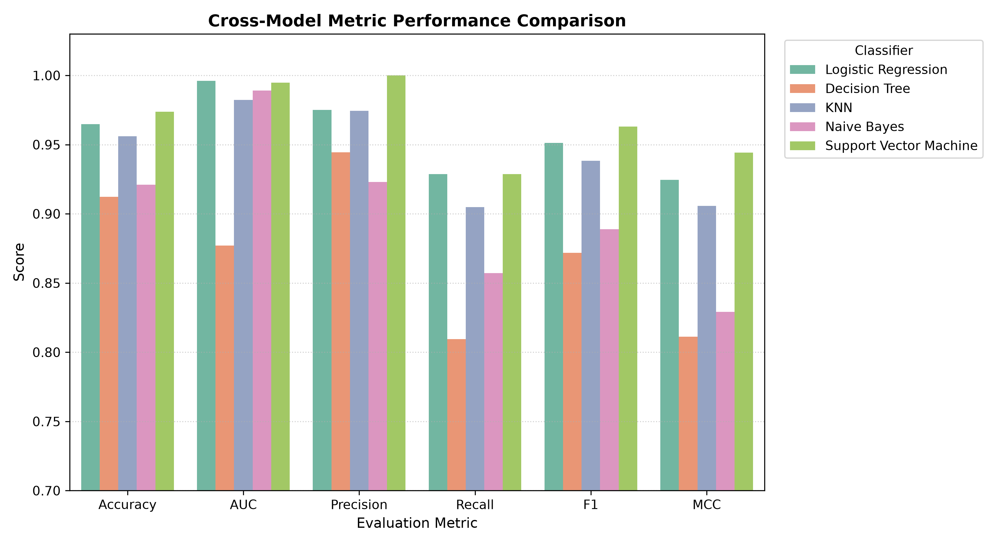
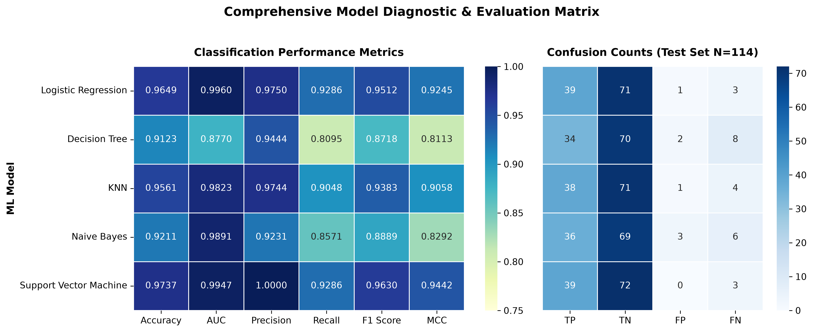

# Breast Cancer Diagnosis using Machine Learning

A small end-to-end machine learning project where I trained five classification models on the Wisconsin Breast Cancer Diagnostic dataset and compared their performance. The trained models are wrapped in a Streamlit app that lets you upload a test CSV, pick a model, and see the evaluation metrics without retraining anything.

## 1. Problem Statement

Breast cancer diagnosis is a binary classification problem. Given a set of measurements taken from a digitized image of a breast mass, the goal is to predict whether the mass is benign or malignant.

The project answers a simple question: among the standard classification algorithms, which one separates benign and malignant cases best on this dataset, and how large is the gap between them? Accuracy alone can be misleading on medical data, so I also looked at AUC, precision, recall, F1 and MCC. In this context a false negative (predicting benign when the mass is actually malignant) is the costliest mistake, so recall matters a lot.

## 2. Dataset Description

| Property | Details |
|---|---|
| Dataset | Breast Cancer Wisconsin (Diagnostic), WDBC |
| Source | UCI Machine Learning Repository |
| Instances | 569 |
| Input features | 30 numeric features |
| Target | `diagnosis` (1 = Malignant, 0 = Benign) |
| Class distribution | 357 benign, 212 malignant |
| Missing values | None |

The 30 features come from ten cell nucleus measurements: radius, texture, perimeter, area, smoothness, compactness, concavity, concave points, symmetry and fractal dimension. For each measurement the dataset provides the mean value, the standard error and the "worst" (largest) value, which gives 10 x 3 = 30 features.

The `id` column was dropped because it is only an identifier. The diagnosis label was mapped from `M`/`B` to `1`/`0`. The data was split 80/20 with stratification on the target (`random_state = 42`), which gives 455 training rows and 114 test rows. The test rows were saved as `test_data.csv`, and this is the file used in the app. All features were standardised using a `StandardScaler` fitted only on the training data.

The dataset satisfies the assignment requirements of at least 12 features and at least 500 instances.

## 3. Repository Link

GitHub repository: [https://github.com/2026ak05128-Mrunalini-Ronghe/Machine-Learning-Classifier.git](https://github.com/YOUR-GITHUB-USERNAME/ml-assignment-2)

Live Streamlit app: [https://Machine-Learning-Classifier.streamlit.app]

## 4. Models Used

Five classifiers were trained on the same scaled training data and evaluated on the same 114-row test set:

1. Logistic Regression (`max_iter=1000`)
2. Decision Tree Classifier (`max_depth=4`)
3. K-Nearest Neighbors (`n_neighbors=5`)
4. Naive Bayes (Gaussian)
5. Support Vector Machine (RBF kernel, `probability=True`)

### Comparison Table

| ML Model Name | Accuracy | AUC | Precision | Recall | F1 | MCC |
|---|---|---|---|---|---|---|
| Logistic Regression | 0.9649 | 0.9960 | 0.9750 | 0.9286 | 0.9512 | 0.9245 |
| Decision Tree | 0.9123 | 0.8770 | 0.9444 | 0.8095 | 0.8718 | 0.8113 |
| KNN | 0.9561 | 0.9823 | 0.9744 | 0.9048 | 0.9383 | 0.9058 |
| Naive Bayes | 0.9211 | 0.9891 | 0.9231 | 0.8571 | 0.8889 | 0.8292 |
| Support Vector Machine | 0.9737 | 0.9947 | 1.0000 | 0.9286 | 0.9630 | 0.9442 |

### Observations

| ML Model Name | Observation about model performance |
|---|---|
| Logistic Regression | Very strong and consistent. Accuracy of 96.49% with an AUC of 0.996 shows that a linear boundary is already enough for this dataset. It made 3 false negatives and 1 false positive. Fast to train and easy to interpret. |
| Decision Tree | Weakest of the five. Accuracy dropped to 91.23% and AUC to 0.877. Limiting depth to 4 reduced overfitting, but the tree still produced 8 false negatives, which is a concern for a medical use case. Small changes in the data can also change the splits. |
| KNN | Close to logistic regression with 95.61% accuracy and 0.9823 AUC. It benefits from feature scaling and did well with k = 5, but it is slower at prediction time and its results depend on the choice of k. It made 4 false negatives. |
| Naive Bayes | AUC is high (0.9891) but thresholded metrics are lower, with 92.11% accuracy and only 85.71% recall. The independence assumption is clearly violated here because radius, perimeter and area are highly correlated, which explains the gap. |
| Support Vector Machine | Best overall. Accuracy 97.37%, AUC 0.9947, MCC 0.9442 and perfect precision, meaning no benign case was wrongly flagged as malignant. Recall of 92.86% means it still missed 3 malignant cases, so there is room to improve if recall is prioritised. |
| Overall, Winner for your dataset? | Support Vector Machine (RBF kernel). It has the highest accuracy, F1 and MCC, and the best balance between precision and recall. Logistic Regression is a close second and would be a good choice if a simpler, explainable model is needed. |

## 5. Visual Comparison

ROC curves for all five models:



Metric-by-metric bar chart:



Combined view of metrics and confusion counts on the test set:



The ROC curves are packed near the top-left corner for four of the models. The Decision Tree is visibly the lowest, which matches its lower AUC. In the bar chart the Decision Tree again stands out as the weakest on AUC and recall, while SVM and Logistic Regression stay near the top on almost every metric.

## 6. Streamlit App

The app (`app.py`) loads the saved artifacts from the `model/` folder, so nothing is retrained on the uploaded data.

Features:

- CSV upload in the sidebar, with `test_data.csv` used as the default when no file is uploaded
- Dropdown to switch between the five trained models
- Six metric cards: Accuracy, AUC, Precision, Recall, F1 and MCC
- Confusion matrix and full classification report for the selected model
- Expander to inspect the uploaded test data
- Input validation so the app stops with a clear message if the target column or any required feature is missing

## 7. Project Structure

```
Assignment2/
|-- app.py                          # Streamlit application
|-- model_training.ipynb            # Notebook used for EDA, training and plots
|-- requirements.txt                # Dependencies
|-- test_data.csv                   # 114-row hold-out test set (30 features + diagnosis)
|-- wdbc.data                       # Raw UCI dataset
|-- wdbc.names                      # Dataset description
|-- roc_curves_comparison.png
|-- metrics_comparison_barchart.png
|-- model_diagnostic_matrix.png
|-- model/
    |-- logistic_regression.joblib
    |-- decision_tree.joblib
    |-- knn.joblib
    |-- naive_bayes.joblib
    |-- svm.joblib
    |-- scaler.joblib
    |-- feature_columns.joblib
```

## 8. How to Run Locally

```bash
pip install -r requirements.txt
streamlit run app.py
```

To regenerate the models and plots, run `model_training.ipynb` from top to bottom. It rewrites `test_data.csv`, the artifacts inside `model/` and the three PNG files.

## 9. Conclusion

All five models performed well on this dataset, with accuracies between 91% and 97%. The SVM came out on top, followed closely by Logistic Regression. The Decision Tree was the weakest, mainly because of its low recall and unstable splits. Since the differences between the top models are small, the choice would really depend on what matters more in practice: a simple explainable model, or the best possible separation of the two classes.
